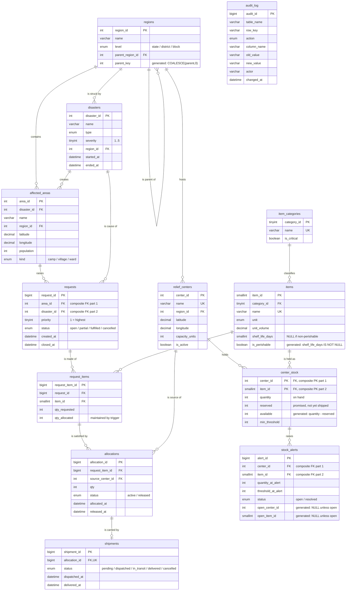

# Design

Phase 1 deliverable. This document is the schema argument: what the entities
are, why the keys and constraints are what they are, where each piece of logic
lives, and what was deliberately left out. The DDL that implements it arrives
in Phase 2; the formal normalization proof is in
[NORMALIZATION.md](NORMALIZATION.md), also Phase 2.

Nothing in this file is measured. It contains no performance claims. Index
choices are justified by `EXPLAIN` output in Phase 6, not here.

---

## 1. What the system has to do

One sentence: **when a disaster generates a request for supplies, find the
nearest relief centers that have the stock, commit that stock to the request,
and never let two requests be promised the same unit.**

Everything else follows from that last clause. It is a concurrency problem
wearing a logistics costume.

The requirements, restated as things the database must guarantee:

| # | Guarantee |
|---|---|
| R1 | Stock can never go negative, whoever writes to it and however they write |
| R2 | The same physical unit can never be committed to two requests |
| R3 | An allocation can never exceed what is still unmet on its request line |
| R4 | A request's status always reflects how much of it is actually allocated |
| R5 | Stock falling below its threshold raises exactly one open alert, not many |
| R6 | Every change to stock or allocations is attributable: who, when, old, new |
| R7 | Partial fulfilment is normal, not an error |
| R8 | A cancelled request returns its stock, and the history of the attempt survives |

---

## 2. The domain in words

A **region** is a place. Regions nest: a state contains districts, a district
contains blocks. This is a tree, so the table points at itself, and reports
that roll up by region use a recursive CTE.

A **relief center** sits in a region at a known latitude and longitude, and has
a finite storage **capacity**. It holds **stock**: for each item, how many
units are on hand, how many of those are already promised to someone, and the
level below which somebody should be told to restock.

An **item** is a kind of supply — rice, tarpaulin, ORS sachets. Items have a
unit of measure, a volume per unit (so "capacity" means something), and
optionally a shelf life, which is what makes an item perishable. Items belong
to **categories**, and a category can be marked critical.

A **disaster** happens: a type, a severity, an affected region, a start time.
It gives rise to **affected areas** — camps, villages, wards — each with a
population and a location.

An affected area raises **requests**. A request has a priority and a status,
and consists of one or more **request items**: this many units of that item.

The system answers a request by creating **allocations**: this much of this
request line, out of that center's stock. One request line can draw on several
centers; that is partial fulfilment accumulating into full fulfilment.

An allocation does not immediately empty the shelf. It **reserves** the stock —
the goods are still physically in the warehouse. A **shipment** is what
actually moves them, and only on dispatch does the on-hand quantity fall. This
distinction is argued in §6.1.

When stock drops below its threshold a **stock alert** is raised. Every change
to stock and to allocations is written to the **audit log**.

---

## 3. ER diagram



`audit_log` has no relationship lines on purpose. See §6.4.

---

## 4. Keys and constraints, table by table

The rule followed throughout: **a surrogate integer primary key, plus a UNIQUE
constraint on the real-world key.** The surrogate gives short, stable foreign
keys; the UNIQUE constraint is what actually keeps the data honest and is what
makes the BCNF argument work in Phase 2 — a table whose natural key is only a
comment is a table that will eventually hold the same row twice.

`center_stock` is the one exception: its primary key is the composite
`(center_id, item_id)`, because a stock row *is* the pairing. A surrogate key
there would add a column and buy nothing, and the composite PK is also the
index the allocator locks against.

### regions

- `UNIQUE (parent_key, name)` where `parent_key` is a generated column
  `COALESCE(parent_region_id, 0)`. Two districts in different states may share
  a name; two districts in the same state may not. The generated column is
  there because of a MySQL detail with teeth — see §7.1.
- `CHECK`: a `state` has no parent, anything else must have one. The tree has
  exactly one kind of root.
- Self-referencing FK is `ON DELETE RESTRICT`: deleting a state must not
  silently orphan or delete its districts.

### relief_centers

- `latitude DECIMAL(9,6)`, `longitude DECIMAL(9,6)` — **not** `FLOAT` or
  `DOUBLE`. Binary floating point cannot represent most decimal coordinates
  exactly, so `lat = 13.082680` can be false for a row that was inserted with
  that literal, and two runs of the same distance calculation can disagree in
  the last digits. `DECIMAL(9,6)` is exact, sorts and compares predictably, and
  6 decimal places is about 11 cm at the equator — far beyond what matters for
  choosing a warehouse. The arithmetic inside `haversine_km()` is still
  floating point; the *stored* values are exact, which is what makes the seed
  data reproducible and the hand-computed expectations in Phase 3 checkable.
- `CHECK` on both coordinates for their valid ranges, `CHECK (capacity_units > 0)`.
- `is_active` rather than deleting a center: closing a warehouse must not
  destroy the record of what it shipped.

### items

- `shelf_life_days` is `NULL` for a non-perishable item.
- `is_perishable` is a **generated column**, `shelf_life_days IS NOT NULL`.
  The brief asks for both a perishable flag and a shelf life, but those two
  facts determine each other, so storing both independently is a redundancy
  that *will* eventually disagree — a row marked non-perishable with a 7-day
  shelf life. Making the flag generated keeps both attributes available to
  queries while making the contradiction unrepresentable. This is the cheapest
  possible fix for an update anomaly: delete the anomaly's home.
- `unit_volume > 0`, so "remaining capacity" in §8 is a real number rather than
  a count of unlike things.

### center_stock

- Composite PK `(center_id, item_id)`.
- `CHECK (quantity >= 0)`, `CHECK (reserved >= 0)`, `CHECK (reserved <= quantity)`.
- `available` is a generated `STORED` column, `quantity - reserved`. The
  allocator's question is always "how much can I promise", and a generated
  column cannot drift from its inputs the way a maintained one can.
- A secondary index on `(item_id, center_id)` — the reverse of the PK. This is
  deliberate and is the subject of §8.2.

### disasters, affected_areas

- `severity BETWEEN 1 AND 5`, `population > 0`, coordinates range-checked.
- `CHECK (ended_at IS NULL OR ended_at >= started_at)`. An interval that ends
  before it starts is not a data-entry problem to be reported later; it is a
  row that should never have been accepted.
- `affected_areas` carries `UNIQUE (area_id, disaster_id)` in addition to its
  primary key. That looks redundant — `area_id` alone is already unique — but
  MySQL requires the columns a foreign key points at to be the leftmost prefix
  of some index, and `requests` points at exactly that pair. See §6.2.

### requests, request_items

- `priority BETWEEN 1 AND 5`, where **1 is highest**. Written down here because
  a reader's instinct is the opposite, and `ORDER BY priority ASC` in
  `allocate_open_requests` only reads correctly if you know this.
- `CHECK ((status IN ('fulfilled','cancelled')) = (closed_at IS NOT NULL))`.
  A closed request has a closing time and an open one does not — enforced,
  rather than hoped for. This is the pattern used wherever a status and a
  timestamp encode the same fact.
- `request_items`: `UNIQUE (request_id, item_id)` — one line per item per
  request, so "add 50 more rice" updates a line instead of creating a second
  one that the allocator would then satisfy independently.
- `CHECK (qty_allocated <= qty_requested)` is R3 as a constraint. The trigger
  in Phase 4 enforces it earlier and with a better error message, but the
  constraint is the backstop that holds even if a trigger is dropped.

### allocations

- `CHECK (qty > 0)`. A zero-quantity allocation is noise; a negative one is a
  theft.
- `status` is `active` or `released`, with `CHECK ((status = 'released') = (released_at IS NOT NULL))`.
- Cancellation **releases** rather than deletes. See §6.3.

### stock_alerts

- Composite FK to `center_stock (center_id, item_id)`: an alert about stock
  that does not exist is meaningless.
- R5 — at most one *open* alert per (center, item) — is enforced by a unique
  index over two generated columns that are `NULL` unless the row is open.
  §7.1 explains why this works and §7.2 explains why the trigger still has to
  be careful.

### audit_log

- No foreign keys, no `ON DELETE` rules, nothing pointing in or out. §6.4.

### Foreign key action policy

The default everywhere is `ON DELETE RESTRICT ON UPDATE CASCADE`: relief
history must not evaporate because somebody tidied up a lookup table, while a
corrected surrogate key should follow. The exceptions are deliberate:

| Child | Parent | ON DELETE | Why |
|---|---|---|---|
| `request_items` | `requests` | `CASCADE` | A request line has no existence apart from its request. Deleting the request and leaving the lines is not a state worth representing. |
| `allocations` | `request_items` | `RESTRICT` | An allocation is a record of stock having been committed. It outlives the request. |
| everything else | | `RESTRICT` | |

Those two interact in a way worth stating out loud, because it is the whole
point: **deleting a request that has allocations fails.** The delete cascades
to `request_items`, the cascade runs into `RESTRICT` from `allocations`, and
the entire statement is rolled back. So a request with history cannot be
deleted at all, while a request that was only ever a draft can be. That is the
intended policy, and `cascade_blocked_by_restrict` in `tools/capabilities.sql`
proves the server behaves this way rather than assuming it.

This is also why `cancel_request` exists. Cancelling is a state change, not a
`DELETE`.

---

## 5. Where each piece of logic lives

| Concern | Lives in | Why not elsewhere |
|---|---|---|
| R1 no negative stock | trigger | Must hold against *any* client, including a human in `mysql` at 2am. Application code cannot promise this. |
| R2 no double-commit | procedure (`SELECT ... FOR UPDATE`) | A trigger fires per row inside someone else's statement; it cannot take the lock *before* the decision is made. Only the caller can. |
| R3 allocation ≤ remaining | trigger, plus a `CHECK` backstop | Cheap to check per row, and the error message can name the request line. |
| R4 request status | trigger (`AFTER INSERT`/`UPDATE` on `allocations`) | Keeping it next to the write that changes it is the only way it cannot be forgotten. |
| R5 low-stock alerts | trigger (`AFTER UPDATE` on `center_stock`) | Same reason. Any path that changes stock should raise the alert, not just the allocator. |
| R6 audit | trigger | A caller that could skip the audit is not an audit. |
| R7 partial fulfilment | procedure | It is a loop with a decision in it, which is what procedures are for. |
| Which center, how much | procedure (`allocate_request`) | Needs ordering by distance, a transaction, locks in a chosen order, and a summary returned. A trigger can do none of those. |
| R8 cancellation | procedure | Multi-table, multi-row, must be atomic. |

The dividing line, stated as a rule: **triggers enforce invariants, procedures
make decisions.** Two facts about MySQL force it and are worth being able to
recite:

1. **A trigger cannot contain `COMMIT` or `ROLLBACK`.** It runs inside the
   transaction of the statement that fired it. So anything that needs to
   succeed-or-undo as a unit must be a procedure.
2. **A trigger cannot modify the table that fired it.** No `AFTER UPDATE` on
   `center_stock` may write to `center_stock`. This is why the low-stock alert
   writes to a separate `stock_alerts` table rather than setting a flag on the
   stock row, and it is why the chain
   `allocations → center_stock → stock_alerts` runs in one direction only.
   Had the design wanted `center_stock.alert_raised`, the whole trigger
   approach would have collapsed.

### What triggers cost

Worth being honest about in a viva, because "I used triggers" is not by itself
a virtue:

- They are **invisible**. A `DELETE` that mysteriously fails is harder to debug
  than a function you can read, and a stack of triggers firing each other is
  worse.
- They **cannot be skipped**, including by a bulk load. Phase 3's large seed
  therefore has to either tolerate the trigger cost or load with triggers in
  mind; whichever it does will be written down.
- They **run per row**, so a statement touching many rows pays for each.
- They are **the only** way to guarantee an invariant against every client.

That last point is why they are here, and the rule above is where the line was
drawn.

---

## 6. Four decisions that deserve an argument

### 6.1 Allocation reserves stock; shipping removes it

The brief says the allocation trigger "decrements `center_stock`". There are
two coherent readings, and they lead to different schemas.

**The literal reading**: on allocation, `quantity` drops. Simple. But then
`reserved` — which the brief also asks for — has nothing left to mean, and the
database says the shelf is empty while the sacks are still sitting on it.

**The reading implemented here**: on allocation, `reserved` rises and
`available` (generated as `quantity - reserved`) falls. On dispatch, `quantity`
and `reserved` both fall. The stock row then tells the truth at every moment:
`quantity` is what is physically present, `reserved` is what is promised,
`available` is what may still be promised.

This was chosen because it is what makes `reserved` and `shipments` load-bearing
rather than decorative, and because "is it on the shelf" and "is it spoken for"
are genuinely different questions that a warehouse has to answer separately.
The allocation trigger still writes to `center_stock`, as the brief requires.

The cost: fulfilment now has two meanings that must be kept distinct in every
report and in the README.

- A request is **fulfilled** when it is fully *allocated* — promised in full.
- Goods are **delivered** when a shipment says so.

A request can be fulfilled with nothing yet delivered. Phase 6's views name
which of the two they mean, and `v_request_status` reports both.

> **Review question 1 for Kunal.** This is the one place the design departs
> from the most literal reading of your brief. If you would rather have the
> simpler model, say so now: the change is confined to one trigger and one
> procedure, and `reserved` would then be dropped rather than left meaningless.

### 6.2 `requests.disaster_id` is redundant, and a composite foreign key makes that safe

A request points at an affected area, and an area already belongs to a
disaster. So `requests.disaster_id` is determined transitively:
`request_id → area_id → disaster_id`. Strict 3NF says remove it and join.

It is kept, for two reasons: `allocate_open_requests(disaster_id)` and every
per-disaster report start from a disaster, and that is the hot path.

Keeping it creates a real update anomaly: a request could claim disaster 7
while its area belongs to disaster 3. The usual fix is a trigger. The better
fix is to make the state unrepresentable:

```sql
FOREIGN KEY (area_id, disaster_id)
    REFERENCES affected_areas (area_id, disaster_id)
```

Now the pair must exist in `affected_areas` as a pair, so the two columns
cannot disagree. No trigger, no application discipline — the constraint system
does it, which is why `affected_areas` carries that extra `UNIQUE (area_id,
disaster_id)` for the FK to point at.

So the honest answer to "is your schema in 3NF" is: **yes, with one documented
exception, where the transitive dependency is kept for query reasons and the
anomaly it would cause is made impossible by a composite foreign key rather
than by a trigger.** Phase 2's `NORMALIZATION.md` gives the FDs and shows the
strict-3NF alternative alongside.

### 6.3 Cancellation releases; it does not delete

`cancel_request` could delete the allocation rows. It marks them `released`
instead, stamps `released_at`, returns the reserved stock, and recomputes the
request's status.

Why: "we promised this and then took it back" is information. A relief
operation that is audited will be asked what was committed and when it was
withdrawn, and rows that were deleted cannot answer. Keeping them also means
`audit_log` and `allocations` tell the same story rather than one contradicting
the other.

The cost, stated plainly: **every query about current commitments must filter
`status = 'active'`.** A forgotten filter double-counts released stock. Phase 6
puts that filter inside the views so that ordinary queries cannot get it wrong,
and the Phase 4 tests include a cancel-then-reallocate case that would fail if
the filter were missing.

### 6.4 The audit log has no foreign keys

`audit_log` references nothing and nothing references it. That is not an
oversight.

An audit row records that *something happened to a row that may since have been
deleted*. A foreign key would mean either that history blocks deletion forever,
or that deleting a row quietly erases the record of what was done to it.
Both are worse than a `VARCHAR` row key.

So the row identity is stored as text — `'center_id=3,item_id=7'` — the table
name as text, and the actor as
`COALESCE(@dra_actor, CURRENT_USER())`, which lets a procedure record a
meaningful actor while still falling back to the database user. The log is
append-only by convention; making that a `GRANT` rather than a convention is
listed under future work.

---

## 7. MySQL-specific limits that shaped this design

Three of these were checked against the running server by
`tools/capabilities.sql` rather than taken on trust.

### 7.1 MySQL has no partial indexes, and `NULL` is the workaround

PostgreSQL can write the constraint R5 asks for directly:

```sql
-- PostgreSQL. Not available in MySQL.
CREATE UNIQUE INDEX ON stock_alerts (center_id, item_id) WHERE status = 'open';
```

MySQL has no `WHERE` clause on an index. But it has a different rule that can
be turned into one: **a multi-column `UNIQUE` index does not constrain rows in
which any indexed column is `NULL`.** So two generated columns that go `NULL`
the moment an alert is resolved give exactly the wanted behaviour — open rows
are held unique, resolved rows are ignored:

```sql
open_center_id INT      GENERATED ALWAYS AS (IF(status = 'open', center_id, NULL)) STORED,
open_item_id   SMALLINT GENERATED ALWAYS AS (IF(status = 'open', item_id,   NULL)) STORED,
UNIQUE KEY uq_one_open_alert (open_center_id, open_item_id)
```

The same MySQL rule is a *hazard* in `regions`: `UNIQUE (parent_region_id,
name)` would silently permit two states of the same name, because both have a
`NULL` parent and `NULL`s do not collide. Hence the `parent_key` generated
column, `COALESCE(parent_region_id, 0)`, which has no `NULL`s to hide behind.

One fact, used as a tool in one table and defended against in another. It is
worth being able to explain both directions.

### 7.2 "Check, then insert" is a race; the upsert is not

The obvious low-stock trigger is: if no open alert exists, insert one. Under
concurrency two sessions can both find none, both insert, and the second hits
the unique index from §7.1 — which raises an error *inside a trigger*, which
fails the `UPDATE` to `center_stock` that fired it, which rolls back a perfectly
valid allocation. A monitoring feature would be able to break the thing it
monitors.

So the trigger does not check. It writes:

```sql
INSERT INTO stock_alerts (...) VALUES (...)
ON DUPLICATE KEY UPDATE alert_id = alert_id;   -- deliberate no-op
```

One atomic statement, no window to lose, no error to handle. The index
guarantees the invariant and the upsert makes hitting it harmless — the
constraint and the trigger agree instead of fighting.

`upsert_noop_on_duplicate` in the capability probe confirms the no-op upsert
behaves this way on the running server.

### 7.3 Written for 8.0.16+, verified on 9.5.0

`CHECK` constraints were parsed and *silently ignored* before MySQL 8.0.16.
Half the guarantees in §4 would evaporate on 8.0.15 with no error, so 8.0.16 is
the floor, and nothing newer than that is used.

The development machine runs 9.5.0. **Compatibility with 8.0.x is a syntax
choice, not a measurement** — there is no 8.0 server here to test on, and
`docs/RESULTS.md` will record it as `not measured` rather than as a claim.
Running `./run.sh check` on an 8.0 server is how anyone can verify it in one
command, which is most of why the probe exists.

---

## 8. Concurrency and indexing: the plan, not the results

Both are stated here as intent. Neither is claimed until a script proves it —
§7 of the sprint produces `CONCURRENCY.md` from captured output, and Phase 6
produces `INDEXING.md` from `EXPLAIN`.

### 8.1 One global lock order

Two sessions that lock the same two rows in opposite orders deadlock. The fix
is not retry logic, it is to make the situation impossible: **every procedure
that locks `center_stock` locks in `(center_id, item_id)` order.**

That collides with wanting nearest-first allocation, which is a different
order. So allocation is two steps:

1. **Choose** — read candidate centers *unlocked*, ranked by `haversine_km`,
   and pick the set to draw from.
2. **Commit** — re-read exactly those rows `FOR UPDATE`, ordered by
   `(center_id, item_id)`, and **re-validate** before writing.

Step 2's re-validation is not belt-and-braces, it is the correctness argument.
Step 1 read without a lock, so by the time the lock is held another session may
have taken the stock. Acting on the step 1 numbers is precisely the oversell
bug that Phase 7 demonstrates on purpose before fixing it.

Phase 7 will also provoke a deadlock by locking in the reverse order, capture
the real error 1213, and then show the ordered version surviving the same test.

### 8.2 `(center_id, item_id)` versus `(item_id, center_id)`

`center_stock` gets both: the composite primary key, and a secondary index with
the columns the other way round. They are not interchangeable, and the reason
is the one thing to understand about composite indexes.

A composite index is sorted by its first column, then by its second — like a
phone book sorted by surname then first name. It can satisfy a lookup that
fixes a *leftmost prefix* of its columns, and no other.

- `PRIMARY KEY (center_id, item_id)` answers "what does center 4 hold?"
  (`WHERE center_id = 4`) and "how much rice does center 4 hold?". It cannot
  answer "which centers hold rice?" (`WHERE item_id = 12`) without scanning,
  any more than a phone book can find everyone named Kunal.
- `INDEX (item_id, center_id)` answers "which centers hold rice, and how much?"
  — which is the allocator's question on every single run.

So the second index exists for the hot path. Phase 6 captures the `EXPLAIN`
before and after adding it on the large seed, and records which index the
optimizer actually chose, which is not always the one you expected.

---

## 9. Not built

Listed now so it cannot be quietly forgotten, and repeated in the README's
Limitations section.

| Not built | Why |
|---|---|
| Vehicles, drivers, routing, road distance | Haversine is straight-line distance. Real routing needs a road graph and is a different project. |
| Many allocations per shipment (truck loads) | `shipments` is one-to-one with an allocation. Grouping by vehicle adds a table and changes nothing about the allocation logic. |
| Expiry tracking and FIFO by batch | `items` has a shelf life but `center_stock` has no batches or expiry dates, so stock cannot be allocated oldest-first. This is the largest honest gap. |
| Capacity enforcement on restock | `capacity_units` is reported against but not enforced as a constraint, because enforcing it needs a sum over all items in a center on every write. |
| Role-based `GRANT`s, append-only audit | Stretch goal in the brief; only on request. |
| Any user interface | Stretch goal. The deliverable is the database. |

---

## 10. Open questions for review

1. **§6.1** — reserve-then-ship, or the literal decrement-on-allocation? This
   is the one real fork in the design.
2. **Priority direction.** 1 = highest here. Confirm, because it flips the
   `ORDER BY` in two procedures and every test's expected output.
3. **Severity's role.** `disasters.severity` is stored but does not currently
   affect allocation order, which is driven by `requests.priority` and age.
   Should severity break ties between requests of equal priority from different
   disasters?
4. **Geography.** The seed can use real Tamil Nadu districts and plausible
   coordinates, or obviously synthetic ones. Real places read better in an
   interview; synthetic ones can never be mistaken for a claim about a real
   relief operation. Recommendation: real district names, clearly-labelled
   fictional centers and camps.
